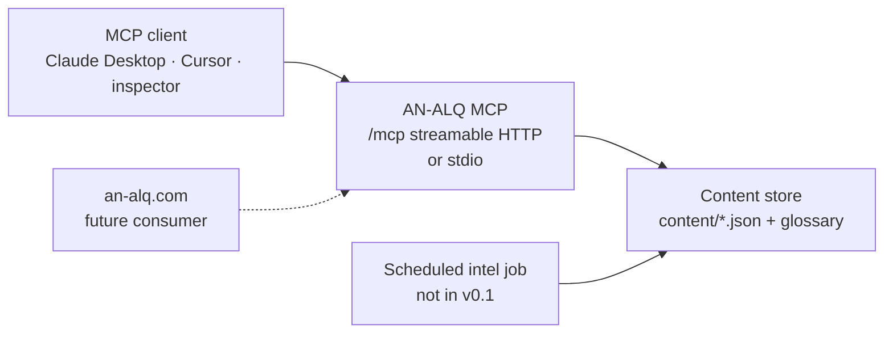

# AN-ALQ MCP

```
+------------------------------------------------------+
|  AN-ALQ                                              |
|  Model Context Protocol                 v0.1         |
|  an-alq.com          future  mcp.an-alq.com          |
|  illustrative figures   ·   sample content store     |
+------------------------------------------------------+
```

[](https://github.com/anthonygenovese/an-alq/actions/workflows/ci.yml)
[](LICENSE)
[](package.json)
[](https://modelcontextprotocol.io)

A read-only [Model Context Protocol](https://modelcontextprotocol.io) server for [AN-ALQ](https://an-alq.com). It serves the public capability catalog, a sample news drop, sample frontier picks, and a short EW glossary. v0.1 is the seed for `mcp.an-alq.com`.

**Capability figures are illustrative**, the same way they are marked on [an-alq.com](https://an-alq.com) and [an-alq.com/capabilities](https://an-alq.com/capabilities). News drops and frontier picks in this repo are **sample data**. This process does not sense, jam, spoof, locate, or engage anything.

## Architecture



The HTTP server is stateless. Each request builds a server, answers, and drops it. Nothing about the caller is written down.

## Tools

| Tool | Input | Returns |
| --- | --- | --- |
| `get_capabilities` | none | Structured catalog drawn from the public site. Every figure is `label: "illustrative"`. |
| `get_news_drop` | `slot`: `morning` \| `midday` \| `afternoon`. Optional `zip`: exactly 5 digits. | One sample drop from `content/news-drops.json`. A ZIP adds a first-digit USPS note and is not stored. |
| `get_frontier_picks` | `month`: `YYYY-MM` | Sample picks from `content/frontier-picks.json`, or `found: false` plus the months that exist. |
| `explain_ew_term` | `term`: glossary id, case-insensitive | A short EW 101 definition (RGPO, VGPO, DRFM, ESM, ELINT, TDOA, AOA, FHSS, DSSS, and neighbors). |

Unknown fields are rejected. There is no name, email, phone, or free-text personal field.

Also exposed:

| Kind | Name | What it is |
| --- | --- | --- |
| Resource | `an-alq://capabilities/summary` | Shorter catalog. Same illustrative figures. Research division closed. |
| Prompt | `zip_check_in` | A check-in whose only argument is a 5-digit ZIP. |

The advanced research division is **not open for briefing**. The tool says that and stops.

## Quickstart

```bash
npm install
npm test
npm start
```

`npm start` listens on `http://127.0.0.1:8787/mcp` (override with `PORT` and `HOST`). Logs go to stderr. `GET /health` returns the name and version.

List the surface without a desktop client:

```bash
npm run smoke
```

Stdio, for a local process spawn:

```bash
npm run start:stdio
```

Stdout is the protocol. Do not pipe `npm run` in front of a desktop config if the runner prints to stdout. Point the client at `node` itself:

```json
{
  "mcpServers": {
    "an-alq": {
      "command": "node",
      "args": ["--import", "tsx", "src/stdio.ts"],
      "cwd": "/absolute/path/to/an-alq"
    }
  }
}
```

### Claude Desktop

Use the stdio block above in `claude_desktop_config.json`. Claude Desktop spawns the process. It does not need the HTTP port.

### Cursor

HTTP, after `npm start`:

```json
{
  "mcpServers": {
    "an-alq": {
      "url": "http://127.0.0.1:8787/mcp"
    }
  }
}
```

Or the same stdio block as Claude. The inspector (`npx @modelcontextprotocol/inspector`) can attach to `http://127.0.0.1:8787/mcp`.

### Vercel

`api/mcp.ts` is a Node function speaking stateless streamable HTTP with JSON responses. `vercel.json` rewrites `/mcp` to `/api/mcp`. `GET /api/health` is the health check.

```bash
npx vercel
```

The public hostname is a later step. See the roadmap.

Local HTTP binds to loopback and checks the `Host` header (`ALLOWED_HOSTS` overrides the list). That check is off in the Vercel function because preview hostnames move.

## Content store

`content/FORMAT.md` is the contract a scheduled job will write. v0.1 ships example JSON only. The loader rejects unknown keys, so the job cannot add a ZIP column without a code change.

| File | Format |
| --- | --- |
| `content/news-drops.json` | `an-alq.news-drop.v1` |
| `content/frontier-picks.json` | `an-alq.frontier-picks.v1` |

`sample: true` travels with `label: "example"`. Reviewed copy uses `sample: false` and `label: "editorial"`.

## Guardrails

- Inputs are Zod objects with `.strict()`. Extra keys fail. ZIP means `^\d{5}$` and nothing else.
- Error text does not repeat the submitted value.
- Stderr logs are an allowlist: event name and a status code. ZIPs and addresses are not logged. The rate-limit key is a hash held in memory for the window, then dropped.
- 60 requests per minute per hashed address, in process. A Vercel cold start resets it. `Cache-Control: no-store` is set on MCP responses.
- No accounts, no sessions, no disk writes.

## Roadmap

1. **mcp.an-alq.com** — this same stateless endpoint, on the public hostname.
2. **OAuth 2.1, if a ZIP is ever stored.** v0.1 does not store one. Persistence is a product decision with authorization in front of it, not a log line added later.
3. **Live content pipeline** — a scheduled job replaces the two JSON files using `content/FORMAT.md`. The server keeps reading.
4. **an-alq.com as a client** — the site reads the same informational endpoint. The endpoint stays informational.

## Development

```bash
npm run lint
npm run typecheck
npm test
```

CI on GitHub Actions runs lint, typecheck, test, and `npm run smoke`.

## License

[MIT](LICENSE) © 2026 Anthony Genovese
