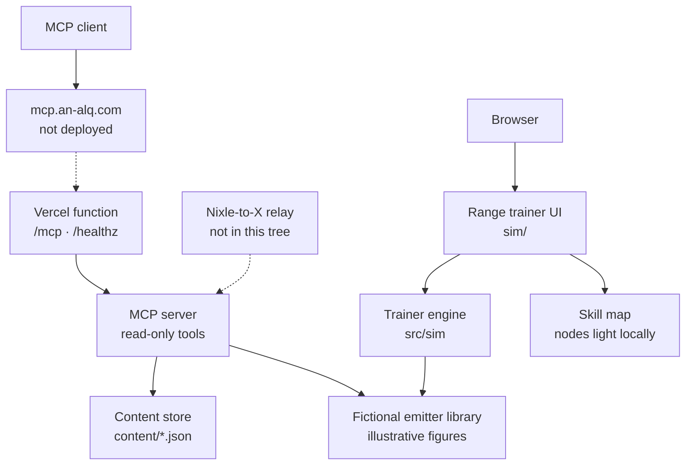

# AN-ALQ

```
AN-ALQ
MCP endpoint  ·  T1 range trainer  ·  skill-map nodes
illustrative figures  ·  synthetic spectrum  ·  no PII retained on the server
an-alq.com                         future  mcp.an-alq.com
```

[](https://github.com/anthonygenovese/an-alq/actions/workflows/ci.yml)
[](https://scorecard.dev/viewer/?uri=github.com/anthonygenovese/an-alq)
[](LICENSE)
[](.nvmrc)
[](https://modelcontextprotocol.io)
[](https://github.com/anthonygenovese/an-alq/actions/workflows/ci.yml)

Read-only [Model Context Protocol](https://modelcontextprotocol.io) server and a Tier 1 training range for [AN-ALQ](https://an-alq.com). The server answers from a static catalog. The trainer draws a synthetic waterfall and lights skill-map nodes from on-device scores. Both are educational. Neither senses, jams, spoofs, locates, or engages anything.

**Every quantitative figure is illustrative.** Emitter names are fictional. News drops and frontier picks in this repo are sample data.

## Surfaces

| Surface          | Path                   | State                                                 |
| ---------------- | ---------------------- | ----------------------------------------------------- |
| MCP server       | `src/`, `api/`         | Shipped. Stateless HTTP and stdio.                    |
| Content store    | `content/`             | Sample JSON. Schema rejects unknown keys.             |
| T1 range trainer | `sim/`                 | Shipped. Vite UI. Synthetic waterfall.                |
| Skill map        | `src/sim/skill-map.ts` | Shipped. T1 nodes can light. T2–T5 nodes stay locked. |
| Trainer engine   | `src/sim/`             | Shared by the UI. Not a network service.              |
| Nixle-to-X relay | —                      | Not in this tree. Design only. See the threat model.  |
| `mcp.an-alq.com` | —                      | Not deployed. Same stateless endpoint, later.         |

## Architecture



The trainer does not call `/mcp` at runtime. Vite bundles the same TypeScript modules the server imports. A later move to `apps/sim`, `packages/mcp-server`, and `packages/relay` is documented in [docs/ARCHITECTURE.md](docs/ARCHITECTURE.md) and is not done here: the trainer landed at `sim/` and the server stays at the repository root.

## Privacy by design

Three rules, enforced in code rather than in a policy paragraph.

**Anonymity.** No accounts, cookies, or session store. The MCP transport sets `sessionIdGenerator: undefined`. The rate-limit key is a SHA-256 of the observed address, held in memory for the window, then dropped. The address itself is not logged.

**No PII.** Tool schemas are Zod objects with `.strict()`. The only personal-shaped field is an optional 5-digit ZIP on `get_news_drop`, and it is not stored. Error text is built from schema messages, which do not echo the submitted value. Logs are a JSON allowlist: `ts`, `event`, `status`, `code`, `rid`, `method`.

**Decay as retention.** The server writes nothing to disk. Rate-limit buckets expire with the window and the map is capped. A cold start on Vercel drops them. There is no profile to delete because no profile is kept. The trainer is the exception that stays on the player's machine: `localStorage` key `an-alq.skill-evidence.v1` holds aggregate attempt counts by fictional category and difficulty. It is not sent to the server. Clearing site data drops it.

Details, including STRIDE for the endpoint and the relay design, are in [docs/THREAT_MODEL.md](docs/THREAT_MODEL.md).

## MCP

| Tool                  | Input                                                                    | Returns                                                                   |
| --------------------- | ------------------------------------------------------------------------ | ------------------------------------------------------------------------- |
| `get_capabilities`    | none                                                                     | Public catalog. Every figure is `label: "illustrative"`.                  |
| `get_emitter_library` | none                                                                     | Fictional training catalog. Names are invented. Figures are illustrative. |
| `get_news_drop`       | `slot`: `morning` \| `midday` \| `afternoon`. Optional `zip`: `^\d{5}$`. | One sample drop. A ZIP adds a first-digit USPS note and is not stored.    |
| `get_frontier_picks`  | `month`: `YYYY-MM`                                                       | Sample picks, or `found: false` plus the months that exist.               |
| `explain_ew_term`     | `term`: glossary id, case-insensitive, max 64                            | A short definition. Nothing is simulated or applied.                      |

| Kind     | Name                                | What it is                                       |
| -------- | ----------------------------------- | ------------------------------------------------ |
| Resource | `an-alq://capabilities/summary`     | Shorter catalog. Research division closed.       |
| Resource | `an-alq://training/emitter-library` | Same fictional library the trainer uses.         |
| Prompt   | `zip_check_in`                      | A check-in whose only argument is a 5-digit ZIP. |

Unknown fields are rejected. There is no name, email, phone, or free-text personal field. The advanced research division is not open for briefing.

`GET /health` and `GET /healthz` return `{ ok, name, version }`. They are not rate limited. MCP routes are: 60 requests per minute per hashed address, 32 KB JSON body, `Cache-Control: no-store`.

## Range trainer

```bash
npm run sim
```

Opens `http://127.0.0.1:5173`. Two surfaces:

| Surface   | What the player does                                                                  |
| --------- | ------------------------------------------------------------------------------------- |
| Skill map | Six sectors. Items are nodes. A node the player has mastered is a lit node.           |
| T1 range  | A time-compressed synthetic waterfall. Name the fictional emitter inside two seconds. |

| Tier | Name                | State                                            |
| ---- | ------------------- | ------------------------------------------------ |
| T1   | Spectral classify   | Playable. The only sector whose nodes can light. |
| T2   | Geolocation fix     | Locked. No coordinates and no fix.               |
| T3   | Response technique  | Locked. Glossary labels only. No transmitter.    |
| T4   | Deception decisions | Locked. No signal is produced.                   |
| T5   | Multi-threat        | Locked.                                          |

The participation ring around the profile mark is a reserved slot. This build does not compute it. T2–T5 nodes use an unavailable criterion and stay unlit.

`npm run build:sim` writes `dist/sim`. That bundle is not what `vercel.json` deploys.

## Quickstart

```bash
npm ci
npm test
npm start
```

`npm start` listens on `http://127.0.0.1:8787/mcp` (`PORT`, `HOST`). Logs go to stderr.

```bash
npm run smoke          # SDK client lists the surface
npm run inspector      # MCP Inspector CLI, pinned in package.json
npm run sim            # trainer
```

Stdio, for a desktop client that spawns a process. Point it at `node`, not at `npm run`, so the runner's banner stays off stdout:

```json
{
  "mcpServers": {
    "an-alq": {
      "command": "node",
      "args": ["--import", "tsx", "src/stdio.ts"],
      "cwd": "/absolute/path/to/an-alq"
    }
  }
}
```

HTTP, after `npm start`:

```json
{
  "mcpServers": {
    "an-alq": {
      "url": "http://127.0.0.1:8787/mcp"
    }
  }
}
```

## Deploy

`api/mcp.ts` is the Vercel Node function. `vercel.json` rewrites `/mcp` to it and `/health` and `/healthz` to `api/health.ts`. The function is capped at 10 seconds. Security headers are set on the function and again at the edge. Content-Security-Policy is limited to the API paths so a later static host for the trainer is not forced into `default-src 'none'`.

This repository does not deploy and does not store secrets. Variables are in [`.env.example`](.env.example):

| Variable          | Where            | Default        | Meaning                                |
| ----------------- | ---------------- | -------------- | -------------------------------------- |
| `HOST`            | local process    | `127.0.0.1`    | Bind address.                          |
| `PORT`            | local process    | `8787`         | Bind port. Vercel sets its own.        |
| `ALLOWED_HOSTS`   | local process    | loopback names | `Host` allowlist. Ignored on Vercel.   |
| `ALLOWED_ORIGINS` | local and Vercel | empty          | Exact browser origins. `*` is ignored. |

Empty `ALLOWED_ORIGINS` denies every cross-origin browser call. Local mode also allows `http://localhost` and `http://127.0.0.1` with a port, for the Inspector UI. There is no API key to set.

## Supply chain

| Control                                          | Where                      |
| ------------------------------------------------ | -------------------------- |
| Pinned actions, `contents: read` by default      | `.github/workflows/`       |
| CodeQL `security-and-quality`                    | `codeql.yml`               |
| npm audit, registry signatures, osv-scanner      | `ci.yml`                   |
| gitleaks 8.30.1, checksum-pinned, full history   | `ci.yml`                   |
| OpenSSF Scorecard, results published             | `scorecard.yml`            |
| Dependabot, npm and GitHub Actions               | `dependabot.yml`           |
| release-please, CycloneDX SBOM, build provenance | `release.yml`              |
| Disclosure                                       | [SECURITY.md](SECURITY.md) |

Signed tags are an owner control. The private key does not live in CI. See [docs/RELEASE.md](docs/RELEASE.md).

## Roadmap

| Item                                       | State                                                                        |
| ------------------------------------------ | ---------------------------------------------------------------------------- |
| MCP server v0.1 and T1 trainer             | On `main`.                                                                   |
| Scorecard, CodeQL, audit, SBOM, provenance | This change. A release is cut by release-please after merge, not by this PR. |
| `mcp.an-alq.com`                           | DNS and a Vercel project. Not done here.                                     |
| OAuth 2.1                                  | Only if a ZIP is ever stored. v0.1 does not store one.                       |
| Live content job                           | Contract is `content/FORMAT.md`. The server keeps reading.                   |
| T2–T5 playable tiers                       | Locked nodes. No engine for them.                                            |
| Nixle-to-X relay                           | Separate work. Public alerts only. No subscriber data.                       |
| Move to `apps/` and `packages/`            | After that relay lands. Not in this PR.                                      |

## Development

Node `22.23.4` (`.nvmrc`). npm. Dev container: `.devcontainer/`.

```bash
npm run format:check
npm run lint
npm run typecheck
npm run typecheck:sim
npm test
npm run build:sim
```

Coverage fails under 85% lines, 80% statements, 80% functions, or 75% branches on `src/` and `api/`. Conventional commits are required on the pull request title. See [CONTRIBUTING.md](CONTRIBUTING.md).

## License

[MIT](LICENSE) © 2026 Anthony Genovese
