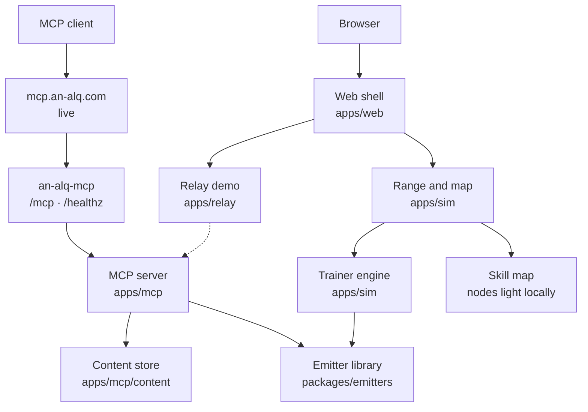

# AN-ALQ

```
AN-ALQ
MCP endpoint  ·  T1 range trainer  ·  skill-map nodes
illustrative figures  ·  synthetic spectrum  ·  no PII retained on the server
an-alq.com                         live    mcp.an-alq.com
```

[](https://github.com/anthonygenovese/an-alq/actions/workflows/ci.yml)
[](https://scorecard.dev/viewer/?uri=github.com/anthonygenovese/an-alq)
[](LICENSE)
[](.nvmrc)
[](https://modelcontextprotocol.io)
[](https://github.com/anthonygenovese/an-alq/actions/workflows/ci.yml)

Read-only [Model Context Protocol](https://modelcontextprotocol.io) server and a Tier 1 training range for [AN-ALQ](https://an-alq.com). The server answers from a static catalog. The trainer draws a synthetic waterfall and lights skill-map nodes from on-device scores. Both are educational. Neither senses, jams, spoofs, locates, or engages anything.

**Every quantitative figure is illustrative.** Emitter names are fictional. News drops and frontier picks in this repo are sample data.

## Surfaces

| Surface            | Path                                         | State                                                                  |
| ------------------ | -------------------------------------------- | ---------------------------------------------------------------------- |
| Web shell          | `apps/web`                                   | Next.js. `/`, `/range`, `/map`, `/relay`. Progress stays on device.    |
| MCP server         | `apps/mcp`                                   | Shipped. Stateless HTTP and stdio.                                     |
| Content store      | `apps/mcp/content`                           | Sample JSON. Schema rejects unknown keys.                              |
| Emitter library    | `packages/emitters`                          | Shared fictional catalog and glossary.                                 |
| T1 range trainer   | `apps/sim`                                   | Shipped. Waterfall and skill map.                                      |
| Skill map          | `apps/sim/src/engine/skill-map.ts`           | Shipped. T1 nodes can light. T2–T5 nodes stay locked.                  |
| Trainer engine     | `apps/sim/src/engine`                        | Shared by the UI. Not a network service.                               |
| Nixle signal relay | `apps/relay`                                 | In progress. Reads public alerts. Does not post. See the threat model. |
| `mcp.an-alq.com`   | Vercel project `an-alq-mcp`, root `apps/mcp` | Live. Not deployed by CI. Same stateless endpoint.                     |

A verified receipt counts the five newest Nixle emails, not the five newest messages in the inbox. The browser lists `INBOX` with `q=from:(nixle.com OR nixle.us)` and `maxResults=5`, so other mail is not fetched and does not use a slot. The copy when the alert is older than that is "no longer in your latest 5 Nixle alerts". The server still requires the DKIM-signed `Date` to fall inside the freshness window (default 60 minutes). `gmail.readonly` can read the whole mailbox; the cap is this client's list call, not Google's scope.

## Architecture



The trainer does not call `/mcp` at runtime. The web shell and the Vite trainer both bundle `apps/sim` and `packages/emitters`. The relay page runs the demo clock in the browser. It does not read a mailbox and it does not post.

## Privacy by design

Three rules, enforced in code rather than in a policy paragraph.

**Anonymity.** No accounts, cookies, or session store. The MCP transport sets `sessionIdGenerator: undefined`. The rate-limit key is a SHA-256 of the observed address, held in memory for the window, then dropped. The address itself is not logged.

**No PII.** Tool schemas are Zod objects with `.strict()`. The only personal-shaped field is an optional 5-digit ZIP on `get_news_drop`, and it is not stored. Error text is built from schema messages, which do not echo the submitted value. Logs are a JSON allowlist: `ts`, `event`, `status`, `code`, `rid`, `method`.

**Decay as retention.** The server writes nothing to disk. Rate-limit buckets expire with the window and the map is capped. A cold start on Vercel drops them. There is no profile to delete because no profile is kept. The trainer is the exception that stays on the player's machine: `localStorage` key `an-alq.skill-evidence.v1` holds aggregate attempt counts by fictional category and difficulty. It is not sent to the server. Clearing site data drops it.

Details, including STRIDE for the endpoint and the relay design, are in [docs/THREAT_MODEL.md](docs/THREAT_MODEL.md).

## MCP

| Tool                  | Input                                                                    | Returns                                                                   |
| --------------------- | ------------------------------------------------------------------------ | ------------------------------------------------------------------------- |
| `get_capabilities`    | none                                                                     | Public catalog. Every figure is `label: "illustrative"`.                  |
| `get_emitter_library` | none                                                                     | Fictional training catalog. Names are invented. Figures are illustrative. |
| `get_news_drop`       | `slot`: `morning` \| `midday` \| `afternoon`. Optional `zip`: `^\d{5}$`. | One sample drop. A ZIP adds a first-digit USPS note and is not stored.    |
| `get_frontier_picks`  | `month`: `YYYY-MM`                                                       | Sample picks, or `found: false` plus the months that exist.               |
| `explain_ew_term`     | `term`: glossary id, case-insensitive, max 64                            | A short definition. Nothing is simulated or applied.                      |

| Kind     | Name                                | What it is                                       |
| -------- | ----------------------------------- | ------------------------------------------------ |
| Resource | `an-alq://capabilities/summary`     | Shorter catalog. Research division closed.       |
| Resource | `an-alq://training/emitter-library` | Same fictional library the trainer uses.         |
| Prompt   | `zip_check_in`                      | A check-in whose only argument is a 5-digit ZIP. |

Unknown fields are rejected. There is no name, email, phone, or free-text personal field. The advanced research division is not open for briefing.

`GET /health` and `GET /healthz` return `{ ok, name, version }`. They are not rate limited. MCP routes are: 60 requests per minute per hashed address, 32 KB JSON body, `Cache-Control: no-store`.

## Range trainer

```bash
pnpm dev
```

Opens the web shell at `http://127.0.0.1:3000`. `/range` is the waterfall. `/map` is the skill map. The standalone Vite trainer is still `pnpm --filter @an-alq/sim dev` at `http://127.0.0.1:5173`.

| Surface   | What the player does                                                                  |
| --------- | ------------------------------------------------------------------------------------- |
| Skill map | Six sectors. Items are nodes. A node the player has mastered is a lit node.           |
| T1 range  | A time-compressed synthetic waterfall. Name the fictional emitter inside two seconds. |

| Tier | Name                | State                                            |
| ---- | ------------------- | ------------------------------------------------ |
| T1   | Spectral classify   | Playable. The only sector whose nodes can light. |
| T2   | Geolocation fix     | Locked. No coordinates and no fix.               |
| T3   | Response technique  | Locked. Glossary labels only. No transmitter.    |
| T4   | Deception decisions | Locked. No signal is produced.                   |
| T5   | Multi-threat        | Locked.                                          |

The participation ring around the profile mark is a reserved slot. This build does not compute it. T2–T5 nodes use an unavailable criterion and stay unlit.

`pnpm --filter @an-alq/sim build` writes the library into `apps/sim/dist` and the standalone trainer into `apps/sim/dist/trainer`. Neither directory is what the MCP project deploys.

## Quickstart

```bash
pnpm install --frozen-lockfile
pnpm test
pnpm --filter @an-alq/mcp start
```

`pnpm --filter @an-alq/mcp start` listens on `http://127.0.0.1:8787/mcp` (`PORT`, `HOST`). Logs go to stderr.

```bash
pnpm smoke       # SDK client lists the surface
pnpm inspector   # MCP Inspector CLI, pinned in apps/mcp
pnpm dev         # web shell
```

Stdio, for a desktop client that spawns a process. Point it at `node`, not at `pnpm`, so the runner's banner stays off stdout:

```json
{
  "mcpServers": {
    "an-alq": {
      "command": "node",
      "args": ["--conditions=development", "--import", "tsx", "src/stdio.ts"],
      "cwd": "/absolute/path/to/an-alq/apps/mcp"
    }
  }
}
```

HTTP, after `pnpm --filter @an-alq/mcp start`:

```json
{
  "mcpServers": {
    "an-alq": {
      "url": "http://127.0.0.1:8787/mcp"
    }
  }
}
```

## Deploy

Two Vercel projects, one repository. This repository does not deploy itself and does not store secrets.

| Project      | Root directory | Domain                                  | What it serves                                  |
| ------------ | -------------- | --------------------------------------- | ----------------------------------------------- |
| `an-alq-web` | `apps/web`     | `an-alq.com` when that host is attached | The Next.js shell                               |
| `an-alq-mcp` | `apps/mcp`     | `mcp.an-alq.com`                        | Streamable HTTP at `/mcp`, health at `/healthz` |

`an-alq-web` settings:

| Setting          | Value                                                                                                                                                                                                                                                 |
| ---------------- | ----------------------------------------------------------------------------------------------------------------------------------------------------------------------------------------------------------------------------------------------------- |
| Framework preset | Next.js                                                                                                                                                                                                                                               |
| Root directory   | `apps/web`                                                                                                                                                                                                                                            |
| Install command  | `pnpm install --frozen-lockfile` from the repository root. Vercel does this when the root directory sits inside the pnpm workspace. Include source files outside the root directory so `packages/emitters`, `apps/sim`, and `apps/relay` are present. |
| Build command    | `pnpm build` (runs in `apps/web`; that script builds `@an-alq/emitters`, `@an-alq/relay`, and `@an-alq/sim`, then `next build`)                                                                                                                       |
| Output directory | Leave empty. Next.js default. Do not set a static export directory.                                                                                                                                                                                   |
| Node.js          | 22.x                                                                                                                                                                                                                                                  |

`output: 'export'` is not turned on. Set `NEXT_STATIC_EXPORT=1` for the later Capacitor build. That flag switches `output: 'export'` and drops the `headers()` function, which a static export cannot emit. The same headers stay in `apps/web/vercel.json` for the Vercel project. The shell has no route handlers, no middleware, and no server-only request APIs. Skill evidence stays in `localStorage`.

`an-alq-mcp` settings:

| Setting          | Value                                                                                                      |
| ---------------- | ---------------------------------------------------------------------------------------------------------- |
| Framework preset | Other                                                                                                      |
| Root directory   | `apps/mcp`                                                                                                 |
| Install command  | `pnpm install --frozen-lockfile` from the repository root, with files outside the root directory included. |
| Build command    | `pnpm build` (builds `@an-alq/emitters`, then typechecks the server)                                       |
| Output directory | `public` (holds a placeholder `index.txt`). `api/mcp.ts` and `api/health.ts` are Vercel Functions.         |
| Node.js          | 22.x                                                                                                       |

`apps/mcp/vercel.json` rewrites `/mcp` to `/api/mcp` and `/health` and `/healthz` to `/api/health`. The MCP function is capped at 10 seconds. Security headers are set on the function and again at the edge. Content-Security-Policy on the API paths is `default-src 'none'`. `mcp.an-alq.com` is attached to the `an-alq-mcp` project. CI does not attach it.

Variables are in [`apps/mcp/.env.example`](apps/mcp/.env.example):

| Variable          | Where            | Default        | Meaning                                |
| ----------------- | ---------------- | -------------- | -------------------------------------- |
| `HOST`            | local process    | `127.0.0.1`    | Bind address.                          |
| `PORT`            | local process    | `8787`         | Bind port. Vercel sets its own.        |
| `ALLOWED_HOSTS`   | local process    | loopback names | `Host` allowlist. Ignored on Vercel.   |
| `ALLOWED_ORIGINS` | local and Vercel | empty          | Exact browser origins. `*` is ignored. |

Empty `ALLOWED_ORIGINS` denies every cross-origin browser call. Local mode also allows `http://localhost` and `http://127.0.0.1` with a port, for the Inspector UI. There is no API key to set.

## Supply chain

| Control                                          | Where                      |
| ------------------------------------------------ | -------------------------- |
| Pinned actions, `contents: read` by default      | `.github/workflows/`       |
| CodeQL `security-and-quality`                    | `codeql.yml`               |
| pnpm audit, registry signatures, osv-scanner     | `ci.yml`                   |
| gitleaks 8.30.1, checksum-pinned, full history   | `ci.yml`                   |
| OpenSSF Scorecard, results published             | `scorecard.yml`            |
| Dependabot, pnpm lockfile and GitHub Actions     | `dependabot.yml`           |
| release-please, CycloneDX SBOM, build provenance | `release.yml`              |
| Disclosure                                       | [SECURITY.md](SECURITY.md) |

Signed tags are an owner control. The private key does not live in CI. See [docs/RELEASE.md](docs/RELEASE.md).

## Roadmap

| Item                                       | State                                                                             |
| ------------------------------------------ | --------------------------------------------------------------------------------- |
| MCP server v0.1 and T1 trainer             | On `main`.                                                                        |
| Scorecard, CodeQL, audit, SBOM, provenance | This change. A release is cut by release-please after merge, not by this PR.      |
| `mcp.an-alq.com`                           | Attached to the `an-alq-mcp` project. Not done by CI.                             |
| OAuth 2.1                                  | Only if a ZIP is ever stored. v0.1 does not store one.                            |
| Live content job                           | Contract is `content/FORMAT.md`. The server keeps reading.                        |
| T2–T5 playable tiers                       | Locked nodes. No engine for them.                                                 |
| Nixle-to-X relay                           | Separate work. Public alerts only. No subscriber data.                            |
| Move to `apps/` and `packages/`            | Done. Deployable apps live in `apps/`. `packages/emitters` is the shared library. |

## Development

Node `22.23.4` (`.nvmrc`). pnpm `12.21.0`, from the `packageManager` field. Dev container: `.devcontainer/`.

```bash
pnpm format:check
pnpm lint
pnpm typecheck
pnpm test
pnpm -r build
```

Coverage fails under 85% lines, 80% statements, 80% functions, or 75% branches on `apps/mcp/src` and `apps/mcp/api`. Conventional commits are required on the pull request title. See [CONTRIBUTING.md](CONTRIBUTING.md).

## License

[MIT](LICENSE) © 2026 Anthony Genovese
